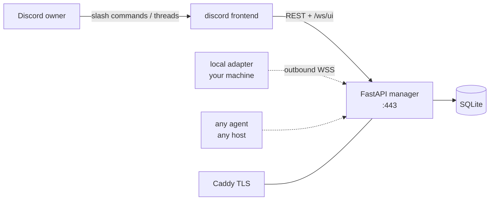

# agent-hub

Discord as the UI for your own coding-agent fleet. One hub (FastAPI +
SQLite) routes Discord threads to outbound-only adapter daemons that drive
agent runtimes on your machines — laptop, VPS, anywhere with outbound
HTTPS. Protocol v1 is additive: adding an agent requires no hub changes.



## Quickstart (localhost, ~5 minutes)

Prereqs: Docker, Python 3.12, and something for the adapter to drive. The
local adapter is POSIX-only (Linux, macOS, or WSL on Windows): it spawns
its runtime in a new process group via `preexec_fn` / `os.killpg`, and the
docs assume `.venv/bin` paths. It needs an `omp` binary on `PATH`, or
`OMP_BIN` (in the adapter's `.env`) pointing at any CLI that accepts the same invocation
(`<bin> --mode=json --cwd <dir> [-r <id>] -p <text>`, see
`agent/local-adapter/agent_adapter/omp.py`).

1. Start the hub:

   ```bash
   cp .env.example .env && sed -i.bak "s|^ADMIN_TOKEN=.*|ADMIN_TOKEN=$(openssl rand -hex 32)|" .env && rm .env.bak
   docker compose up -d        # manager on 127.0.0.1:8000
   until curl -sf http://127.0.0.1:8000/health; do sleep 1; done
   ```

   `.env.example` ships `ADMIN_TOKEN` blank and compose refuses to start
   until it is set: a published default would be a publicly known admin
   token on any host deployed from the copied example. The `sed` command
   (portable across GNU and BSD) fills in a fresh random one; anyone
   holding it has full admin over the hub. Read it back any time with
   `grep '^ADMIN_TOKEN=' .env`.

2. Run an adapter on this machine:

   ```bash
   cd agent/local-adapter
   python3 -m venv .venv && .venv/bin/pip install -r requirements.txt
   cp .env.example .env        # MANAGER_URL=ws://127.0.0.1:8000/ws/agent
                               # AGENT_TOKEN=<ADMIN_TOKEN value for now; print it with:
                               #   grep '^ADMIN_TOKEN=' ../../.env | cut -d= -f2>
                               # DEFAULT_WORKSPACE=<dir the agent may use>
   .venv/bin/python -m agent_adapter
   ```

3. Verify the fleet (from the repo root, in a second terminal — the adapter
   from step 2 keeps running in the first):

   ```bash
   set -a; . ./.env; set +a    # exports ADMIN_TOKEN from the root .env
   curl -s -H "Authorization: Bearer $ADMIN_TOKEN" http://127.0.0.1:8000/agents
   ```

   `omp-local` should list as online. Add the Discord frontend
   (`--profile discord`) when you want threads as the UI — docs/DEPLOY.md.

## Configuration

One root `.env` (compose auto-loads it, but only when containers are
created or recreated: after editing it, run `docker compose up -d` again
with your `--profile` flags). Template with comments: `.env.example`.

| Key | Used by | Required | Default / notes |
|---|---|---|---|
| `ADMIN_TOKEN` | manager; discord (passed as `HUB_TOKEN`) | yes | Ships blank; compose refuses to start until set (`openssl rand -hex 32`). Full admin over the hub. |
| `SQLITE_PATH` | manager | no | `/data/manager.db` (inside the container, on the `manager-data` volume). |
| `DOMAIN` | caddy profile | no | `localhost`. A DNS name gets Let's Encrypt; a bare IP or `localhost` gets Caddy's internal CA. |
| `DISCORD_BOT_TOKEN` | discord profile | yes, for that profile | Blank; the bot exits at startup without it. |
| `DISCORD_OWNER_ID` | discord profile | yes, for that profile | `0`; your Discord user id, owner-gates every command. |
| `DISCORD_GUILD_ID` | discord profile | no | Blank; set it to sync slash commands to that guild instantly instead of globally. |
| `DISCORD_SYNC_CHANNEL_ID` | discord profile | no | Blank; home channel for threads the sync engine creates. |
| `HUB_URL` | discord profile | no | `http://manager:8000` (in-network alias; commented out in `.env.example`). |

The adapter keeps its own env file on the machine where it runs
(`agent/local-adapter/.env.example`) because it is a systemd service,
not a compose stack. The manager also reads
`hub/manager/config/manager.config.toml`, which compose mounts read-only
at `/srv/config`.

## Deploying

- Localhost: the quickstart above (plain WS, no TLS).
- VPS with a domain: set `DOMAIN=hub.example.com` in `.env`, then
  `docker compose --profile caddy up -d`. Caddy gets and renews Let's
  Encrypt automatically.
- VPS, bare IP: set `DOMAIN=<your-vps-ip>` in `.env`, then the same
  `docker compose --profile caddy up -d`. Caddy falls back to a
  self-signed cert; adapter machines must trust it (docs/DEPLOY.md).
- Keep `DOMAIN` in `.env`: an inline `DOMAIN=... docker compose ...` is not
  remembered, and the next compose command without it reverts to
  `localhost`.
- Discord frontend: `docker compose --profile discord up -d` (docs/DEPLOY.md).

## Adding an agent

Anything that speaks protocol v1 can join. Copy `agent/template/` and
follow docs/AGENTS.md: mint a per-agent token, connect to
`/ws/agent`, register, answer sessions.

## Security model

- Every Discord command is owner-gated (`DISCORD_OWNER_ID`).
- Agents authenticate with per-agent bearer tokens: sha-256-hashed at
  rest, TTL (default 30 d), rotation, revocation drops live connections.
- Adapters are outbound-only dialers — they never listen on a port, so
  they work behind NAT/CGNAT with zero port-forwarding.
- The hub is the only public endpoint (TLS at Caddy). Audit details:
  docs/ADAPTER-CONNECTIVITY.md.

## Docs

| Doc | Contents |
|---|---|
| `docs/ARCHITECTURE.md` | components, protocol v1, sync engine, delegation |
| `docs/DEPLOY.md` | hub + caddy + discord deployment, TLS modes, operations |
| `docs/AGENTS.md` | protocol surface + how to add an agent |
| `docs/ADAPTER-CONNECTIVITY.md` | connectivity & security deep-dive |
| `hub/manager/README.md` | hub configuration, REST surface, token model |
| `agent/local-adapter/README.md` | adapter env, systemd install |
