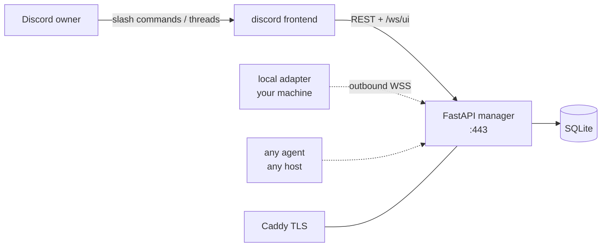

# agent-hub

Discord as the UI for your own coding-agent fleet. One hub (FastAPI +
SQLite) routes Discord threads to outbound-only adapter daemons that drive
agent runtimes on your machines — laptop, VPS, anywhere with outbound
HTTPS. Protocol v1 is additive: adding an agent requires no hub changes.



## Quickstart (localhost, ~5 minutes)

Prereqs: Docker, Python 3.12, and an agent CLI for the adapter to drive
(`omp`, `opencode` or `claude`; see "Runtimes"). The
local adapter is POSIX-only (Linux, macOS, or WSL on Windows): it spawns
its runtime in a new process group via `preexec_fn` / `os.killpg`, and the
docs assume `.venv/bin` paths. The quickstart uses `omp` on `PATH`; set
`RUNTIME_BIN` (in the adapter's `.env`) to an absolute path if the binary
is elsewhere.

1. Start the hub. Put `ADMIN_TOKEN=<any long random string>` in `.env` (an
   existing env file works as-is; `.env.example` is only a sample), then:

   ```bash
   docker compose up -d        # manager on 127.0.0.1:8000
   until curl -sf http://127.0.0.1:8000/health; do sleep 1; done
   ```

   No `.env` yet? `echo "ADMIN_TOKEN=$(openssl rand -hex 32)" >> .env`.
   Compose loads `.env` by itself and refuses to start while `ADMIN_TOKEN`
   is blank, so a deployment never runs on a publicly known default token.
   Anyone holding the token has full admin over the hub.

2. Run an adapter on this machine. Put its settings in
   `agent/local-adapter/.env` (sample: `.env.example` there; `RUNTIME` is
   `omp`, `claude` or `opencode`):

   ```env
   RUNTIME=omp
   MANAGER_URL=ws://127.0.0.1:8000/ws/agent
   AGENT_TOKEN=<the hub's ADMIN_TOKEN, for now>
   DEFAULT_WORKSPACE=<dir the agent may use>
   ```

   ```bash
   cd agent/local-adapter
   python3 -m venv .venv && .venv/bin/pip install -r requirements.txt
   .venv/bin/python -m agent_adapter
   ```

   The adapter loads `.env` itself, and the agent process receives the
   `.env` values it is allowed to see (an API key, or names listed in
   `ENV_PASSTHROUGH`) exactly as if they were exported. Real environment
   variables win over `.env`. A JSON list setting is written plainly:
   `ENV_PASSTHROUGH=["MY_VAR"]`.

3. Verify the fleet (in a second terminal; the adapter keeps running in the
   first). The manager container already holds the token, so nothing needs
   exporting:

   ```bash
   docker compose exec manager python -c "import os,urllib.request as u;print(u.urlopen(u.Request('http://127.0.0.1:8000/agents',headers={'Authorization':'Bearer '+os.environ['ADMIN_TOKEN']})).read().decode())"
   ```

   `omp-local` (the default `<runtime>-local` id) should list as online. Add the Discord frontend
   (`--profile discord`) when you want threads as the UI — docs/DEPLOY.md.

## Runtimes

One adapter instance drives one agent runtime, chosen with `RUNTIME`. Run
several instances side by side (one hub identity each) with the systemd
template unit.

| Runtime | Binary | Streaming | Policies available | Status |
|---|---|---|---|---|
| `omp` | `omp` | token deltas + tool activity | `default`, `readonly`, `edits`, `full` | verified live (omp 18.1.19) |
| `claude` | `claude` | token deltas + tool activity | `default`, `readonly`, `edits`, `full` | **experimental**: verified against fixtures only |
| `opencode` | `opencode` | tool activity only, no token streaming | `default`, `full` only | verified live; set `MODEL` (the configured default may be missing); permission asks are auto-rejected unless `full` |

Each of omp's policy mappings was observed once on omp 18.1.19. None of the
policies is a sandbox.

Details, settings, per-runtime policy mapping, the environment the agent
sees, and migrating from the old `omp-adapter`:
`agent/local-adapter/README.md`. To add another runtime: docs/AGENTS.md.

## Configuration

One root `.env` that compose loads by itself, but only when containers are
created or recreated: after editing it, run `docker compose up -d` again
with your `--profile` flags. Sample with comments: `.env.example`.

| Key | Used by | Required | Default / notes |
|---|---|---|---|
| `ADMIN_TOKEN` | manager; discord (passed as `HUB_TOKEN`) | yes | Any long random string (`openssl rand -hex 32`); compose refuses to start while it is blank. Full admin over the hub. |
| `SQLITE_PATH` | manager | no | `/data/manager.db` (inside the container, on the `manager-data` volume). |
| `DOMAIN` | caddy profile | no | `localhost`. A DNS name gets Let's Encrypt; a bare IP or `localhost` gets Caddy's internal CA. |
| `DISCORD_BOT_TOKEN` | discord profile | yes, for that profile | Blank; the bot exits at startup without it. |
| `DISCORD_OWNER_ID` | discord profile | yes, for that profile | `0`; your Discord user id, owner-gates every command. |
| `DISCORD_GUILD_ID` | discord profile | no | Blank; set it to sync slash commands to that guild instantly instead of globally. |
| `DISCORD_SYNC_CHANNEL_ID` | discord profile | no | Blank; home channel for threads the sync engine creates. |
| `HUB_URL` | discord profile | no | `http://manager:8000` (in-network alias; commented out in `.env.example`). |

The adapter keeps its own env file on the machine where it runs
(`agent/local-adapter/.env.example`) because it is a systemd service,
not a compose stack. The manager also reads
`hub/manager/config/manager.config.toml`, which compose mounts read-only
at `/srv/config`.

## Deploying

- Localhost: the quickstart above (plain WS, no TLS).
- VPS with a domain: set `DOMAIN=hub.example.com` in `.env`, then
  `docker compose --profile caddy up -d`. Caddy gets and renews Let's
  Encrypt automatically.
- VPS, bare IP: set `DOMAIN=<your-vps-ip>` in `.env`, then the same
  `docker compose --profile caddy up -d`. Caddy falls back to a
  self-signed cert; adapter machines must trust it (docs/DEPLOY.md).
- Keep `DOMAIN` in `.env`: an inline `DOMAIN=... docker compose ...` is not
  remembered, and the next compose command without it reverts to
  `localhost`.
- Discord frontend: `docker compose --profile discord up -d` (docs/DEPLOY.md).

## Adding an agent

Anything that speaks protocol v1 can join. Copy `agent/template/` and
follow docs/AGENTS.md: mint a per-agent token, connect to
`/ws/agent`, register, answer sessions.

## Security model

- Every Discord command is owner-gated (`DISCORD_OWNER_ID`).
- Agents authenticate with per-agent bearer tokens: sha-256-hashed at
  rest, TTL (default 30 d), rotation, revocation drops live connections.
- Adapters are outbound-only dialers — they never listen on a port, so
  they work behind NAT/CGNAT with zero port-forwarding.
- The hub is the only public endpoint (TLS at Caddy). Audit details:
  docs/ADAPTER-CONNECTIVITY.md.

## Docs

| Doc | Contents |
|---|---|
| `docs/ARCHITECTURE.md` | components, protocol v1, sync engine, delegation |
| `docs/DEPLOY.md` | hub + caddy + discord deployment, TLS modes, operations |
| `docs/AGENTS.md` | protocol surface + how to add an agent or a runtime driver |
| `docs/ADAPTER-CONNECTIVITY.md` | connectivity & security deep-dive |
| `hub/manager/README.md` | hub configuration, REST surface, token model |
| `agent/local-adapter/README.md` | adapter runtimes, env, systemd instances, migration from omp-adapter |
