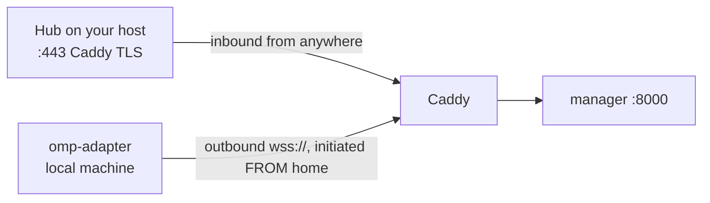

# Adapter Connectivity & Security

How the local adapter is reached from the internet, the current security
stack, and the security model.

---

## 1. Connecting the local adapter from the internet (e.g. from the hub)

### Current design: no inbound port needed

The adapter (`omp-adapter`) is an **outbound-only** WebSocket client. It dials
the hub at `wss://<your-host>/ws/agent`, authenticates with
`AGENT_TOKEN`, and everything the hub wants to send (runs, cancels, sync
nudges) is delivered down that already-established connection.

Implications:

- The local machine **never listens on a port** — `omp-adapter` is a dialer,
  not a server.
- It works from behind NAT, CGNAT (typical home ISP), and firewalls that only
  allow outbound 443.
- **Nothing to expose.** Do not port-forward the adapter machine: there is no
  port to forward. "Connecting from the internet to the adapter" is already
  solved by the hub sending frames over the adapter's outbound socket.
- Multiple adapters work with zero manager changes (protocol v1 is
  adapter-agnostic; each adapter dials in and registers its own `agent_id`).

### If you genuinely need inbound reachability to the local machine

Only needed if some *other* internet service must call the local box
directly (not through the hub). Options, best first:

| Method | How | Public endpoint | Notes |
|---|---|---|---|
| **Cloudflare Tunnel** (`cloudflared`) | Daemon on the local box dials out to Cloudflare's edge; visitors hit `https://<name>.<domain>` | Stable URL, needs a domain you control | No open ports, free, TLS included; best balance |
| **ngrok** | `ngrok http 8080` on the local box | Random URL per run (free tier) | Fastest for a one-off demo; URL churn is a problem for persistent callers |
| **Tailscale / Funnel** | WireGuard mesh; `funnel` publishes a node publicly | Stable; private by default | Private mesh needs the caller on the tailnet; funnel exposes publicly with TLS |
| **SSH reverse tunnel to a VPS** | `ssh -R 8080:localhost:8080 vps` | VPS IP + port | No third party, but fragile (keepalive, reconnect script needed) |
| **frp / rathole** | Self-hosted tunnel server on a VPS, client on the local box | VPS IP/port | More moving parts than cloudflared; useful if you don't want Cloudflare in the path |
| **Router port-forward + DDNS** | Forward WAN port → LAN host; DDNS name for the changing IP | Your public IP | Last resort: opens your home network, IP churn, CGNAT makes it impossible on many ISPs |

**Never** use a raw router port-forward to expose a plain-HTTP dev server —
if a forward is unavoidable, put it behind TLS and an auth proxy.

### Rule of thumb

If the goal is *hub ↔ adapter*, the answer is already in place: **outbound
WSS, no exposure**. Reach for a tunnel (cloudflared) only when a third party
must dial the local machine directly, and prefer tunnels over port-forwarding.

---

## 2. Security stack audit

### What is in place (verified)

| Control | Where | Detail |
|---|---|---|
| Outbound-only adapter | `omp_adapter/client.py` | No listening port on the local machine; unreachable inbound by design |
| Per-agent tokens on WSS | `hub/manager` (`tokens.py`) | sha-256-hashed at rest, pinned to one `agent_id`, TTL (default 30 d), rotation revokes old secrets, revocation drops the live connection |
| Bootstrap token | `ADMIN_TOKEN` env | Wildcard WS + admin REST; re-seeded from env at every boot. It stays: it is the Discord frontend's credential (`/ws/ui` accepts only this admin row). Agents and adapters should use per-agent tokens, not this one |
| REST agent ACL | `hub/manager` (`routes.py`) | `require_agent` on `/agents*`, session create/list/get, grants, messages, run, cancel: a per-agent token acts as its pinned `agent_id` and is checked against the session ACL (hosting agent, creator, explicit grants); the admin token acts with no restriction |
| Admin-only REST | `hub/manager` (`routes.py`) | `require_admin` on `/tokens*`, `PATCH`/`DELETE /sessions/{id}`, `messages/mark-posted`, `messages/count`, `/sessions/missed`, `/sessions/recover-interrupted`, `/sync/nudge`; constant-time, non-ASCII-safe (regression-tested) |
| TLS | `hub/caddy/Caddyfile` | Caddy-issued cert: Let's Encrypt for a DNS `DOMAIN`, internal CA (self-signed) for bare IP/localhost — docs/DEPLOY.md |
| Discord authorization | `frontend/discord` | All `/session`, `/run`, `/agent` commands owner-gated by `DISCORD_OWNER_ID` |
| Workspace sandbox | adapter | `ALLOWED_ROOT` confines any workspace path passed to `omp` |
| Process hygiene | adapter | `preexec_fn` sets `pdeathsig` so a killed adapter cannot orphan running `omp` processes |
| Env hygiene | repo | `.env` files gitignored; no secrets in committed config files |

### Remaining gaps, ranked

1. **No rate limiting / connection caps** on `/ws/agent` or the REST API;
   uvicorn's 64 MiB `ws-max-size` (needed for full agent frames) is a
   memory-amplification surface — unauthenticated sockets are rejected
   pre-accept, but authenticated ones can still be large.
2. **Plaintext at rest.** Journal (`~/.omp-adapter/journal/`) and
   `manager.db` hold full transcripts unencrypted. Acceptable for a
   single-user deployment; disk encryption if the laptop travels.
3. **Bare-IP deployments use Caddy's internal CA** — adapter hosts must trust the CA root (docs/DEPLOY.md). A DNS-named hub avoids this entirely with standard Let's Encrypt.
