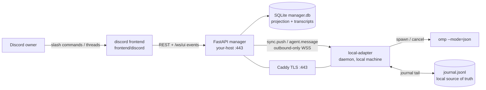

# agent-hub — Architecture & Tech Stack

Discord becomes the UI for locally-owned omp coding sessions. One hub
routes Discord traffic to an outbound-only adapter daemon running next to
the local `omp` binary. The local journal is the source of truth; the hub DB
is a projection kept in step by a continuous two-way sync.

## Components

| Component | Where | Role |
|---|---|---|
| `hub/manager` | container (`manager`) | Hub REST API (`/health`, `/agents`, `/sessions*`, `/tokens*`, `/sync/nudge`), UI event channel at `/ws/ui`, agent WebSocket at `/ws/agent`, sync coordinator, session projection |
| `hub/caddy/` | container (`caddy`) | TLS on :443, reverse-proxies everything (incl. `/ws/agent`) to manager:8000 |
| `frontend/discord` | container (`discord`) | Discord frontend: slash commands, thread↔session mapping, run cards, missed-message rendering. Consumes hub REST + `/ws/ui`; owns no DB |
| `agent/local-adapter/agent_adapter` | local machine, systemd user unit | Registers as agent `omp-local`, spawns/cancels `omp` runs, owns the append-only journal, runs the sync loop. Never listens on a port |
| `omp` | local machine | The agent runtime (`--mode=json` event stream; per-line size aligned with uvicorn's 64 MiB `--ws-max-size`) |

## Tech stack

**Manager** — Python 3.12 (slim image), FastAPI + Uvicorn (`ws-max-size` 64 MiB
so a full agent frame never trips 1009), SQLAlchemy 2.0 async
over aiosqlite/SQLite (WAL), Alembic migrations run at container start,
pydantic v2 settings (case-insensitive env), pytest + pytest-asyncio + httpx.

**Discord frontend** — Python 3.12, discord.py 2.x (slash commands, threads,
live-preview edits paced by `STREAM_INTERVAL`), httpx REST client, `websockets`
event stream with exponential-backoff reconnect, pydantic-settings (env-first),
pytest + pytest-asyncio.

**Adapter** — Python 3.12, `websockets` outbound client with exponential
backoff (cap `RECONNECT_MAX`), pydantic-settings, `asyncio` subprocess driving
`omp` (preexec pdeathsig so a dead adapter can't orphan runs), fsync-per-line
JSONL journal, pytest.

**Infra** — Docker Compose (root `compose.yml`: manager default, `caddy`/`discord`
profiles), TLS at Caddy (`DOMAIN`: Let's Encrypt for DNS names, internal CA for
bare IP/localhost), SQLite in the `manager-data` volume, adapter under
`systemctl --user` with linger (docs/DEPLOY.md).

## Protocol (v1, mirrored `protocol.py` on both sides)

JSON envelopes `{protocol_version, type, request_id?, session_id?, payload}`.
Both sides ignore unknown types — additive evolution, no handshake change.

| Type | Direction | Purpose |
|---|---|---|
| `agent.register` / `agent.heartbeat` | A→H | Identity + liveness; register carries capabilities (`owns_sessions` flips the hub into projection mode) |
| `session.create` / `session.message` / `session.cancel(ack)` | H→A | Drive runs from Discord |
| `session.waiting/activity/delta/completed/failed` | A→H | Live preview: activity label + streamed reply |
| `sessions.snapshot` | A→H | Full session reconcile on every (re)connect |
| `sync.push` / `sync.ack` | A⇄H | Journal tail → projection, cumulative ack + catalog |
| `sync.now` / `sync.need` / `sync.messages` | H→A | `/sync` nudge; transcript mirror pull |
| `delegate.message` | A→H | Agent-to-agent delegation: prompt + hop count; the broker checks ACL, occupancy, hop cap, then drives the host session |
| `delegation.result` | H→A | Broker-relayed round outcome: `{status, reply}` + B's `kind`/`options` verbatim, or `{status, error}` on failure |

## Identity model

Three ids, one convention: **the adapter's local id is the join key.**

- Discord-created sessions: the hub mints `sess_*`, sends it as `session_id`,
  and the adapter uses it as its local id — one shared id.
- Adapter/journal-created sessions: local id is the key; the hub stores it in
  `sessions.omp_session_id` (`new_id("sess")` for the row id). Both address
  styles resolve to one row (`id == local_id OR omp_session_id == local_id`).
- `omp`'s own session UUID is stored in the journal (`omp` field) for
  `--resume`; it is never a session key on either side.

## The feature: continuous two-way sync

**Push (local → hub).** The adapter's sync loop (60 s tick, `/sync` nudge)
reads journal lines `[cursor, cursor+SYNC_BATCH)` and sends `sync.push`. The
hub applies only when `cursor_start == stored.cursor`; otherwise the ack
reports the stored pair and the adapter rewinds. Offsets are the cursors —
exactly-once per offset, no dedupe table. Events: `session_upserted` →
`upsert_projected` (import-or-update, hub vocabulary), `message` → insert with
`request_id` dedupe, lifecycle kinds only advance the cursor.

**Ack.** Cumulative `{instance, cursor, catalog[]}`. The instance pins the
journal identity: a mismatch (fresh hub DB, wiped journal) makes the adapter
rewind to 0 and the hub adopt the journal from scratch — mirrored rows restore
as already-rendered (`posted_at = created_at`), native rows print. Register
time ack means a reconnecting adapter learns its cursor without waiting a
tick. Every projection touch bumps `updated_at` — the picker's recent-first
ordering tracks local activity, not import time.

**Mirror (hub → local).** The ack's catalog lists every adapter-bound row
(`omp_session_id IS NOT NULL`) with message counts. Local count < catalog
count → `sync.need` → hub serves messages in batches → `merge_hub_messages`
journals them (request_id dedupe) and folds a `hub_cursor`. Result: the
journal mirrors every hub transcript, so local omp can resume any conversation.

**Ghost-session protection (added 2026-09-19).** Rows the adapter has not
confirmed (NULL `omp_session_id` — e.g. a `/session new` fired while the
adapter was offline) are hub-internal. The catalog must not advertise them and
the adapter must not adopt by hub id: doing both fabricated ghost local
sessions and rebound hub rows to hub-internal ids.

## Agent-to-agent delegation

Agents are hub clients: with a per-agent token they read the directory
(`GET /agents`), open sessions on each other (`POST /sessions` — the caller
becomes `creator_agent_id`, the row is unowned, a description is mandatory),
and delegate prompts over the channel. `delegate.message` is relayed by the
broker (`delegation.py` in the manager package) as a plain `session.message` to the
hosting agent; its `agent.message` + `session.completed` resolve the
requester's `delegation.result`, with B's `kind`/`options` forwarded
verbatim. The hub stays mechanical: ACL arithmetic (creator + explicit
`read`/`write` grants; the host reads its own sessions implicitly), one
round per session (`busy`), a requester-side result timeout
(`delegation_result_timeout_s`), and a hop cap (`delegation_max_hop`, 3)
that refuses loops — failures come back as `{status, error}`. Delegated
sessions age through the same lifecycle sweeper as every other session
(`delegation_idle_after_s` / `delegation_archive_after_s`), and admin
oversight sees everything.

## Status vocabulary

Adapter speaks `idle/running/failed`; the hub normalizes via `_hub_status`:
`idle + omp id → completed`, `idle without → waiting`, everything in hub
vocabulary passes through. `idle` is never stored on the hub.

## Failure modes

| Failure | Behavior |
|---|---|
| Adapter offline | Sends no-op; unacked cursor resends; Discord reports agent offline |
| Manager down (e.g. 502 via Caddy) | Adapter backs off and retries; journal absorbs everything; snapshot reconciles on reconnect |
| Hub DB wiped | Instance mismatch → adapter rewinds to 0 → full re-import; mirrored rows restored as rendered |
| Journal wiped | New instance → hub resets cursor → journal rebuilt from snapshot + catalog pulls |
| Corrupt journal tail | Truncated after last good line; cursors stay valid |
| Discord 4xx (≠429) | Message marked posted with warning — no poison-reprint loop |

## Operations

- Run: `docker compose up -d` (quickstart in the root README; TLS modes in docs/DEPLOY.md).
- State: SQLite in the `manager-data` volume; adapter journal lives on the adapter machine.
- Tests: `hub/manager`, `frontend/discord`, `agent/local-adapter`, `agent/template` —
  `.venv/bin/python -m pytest tests/ -q` per component; CI runs all four on push.
